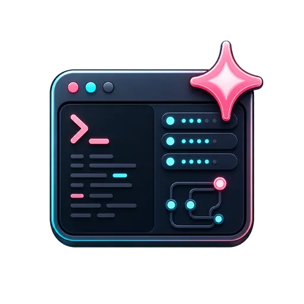
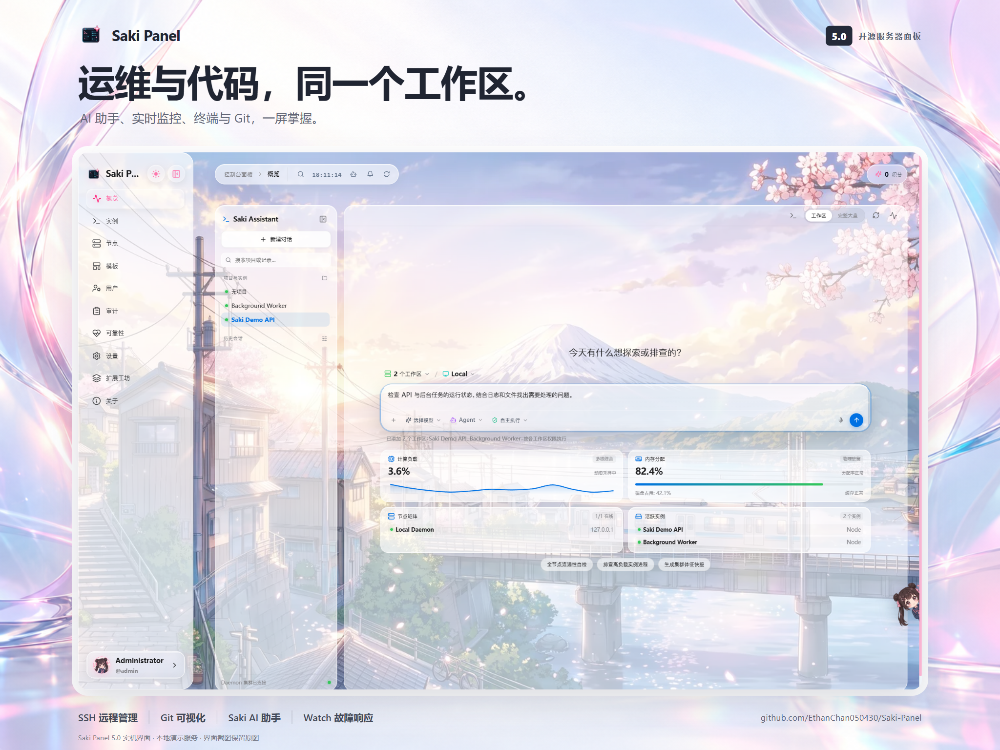
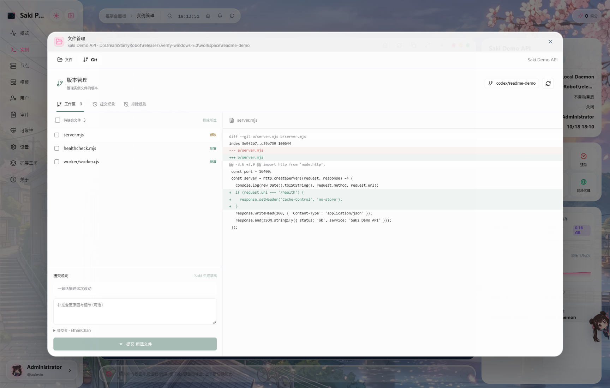
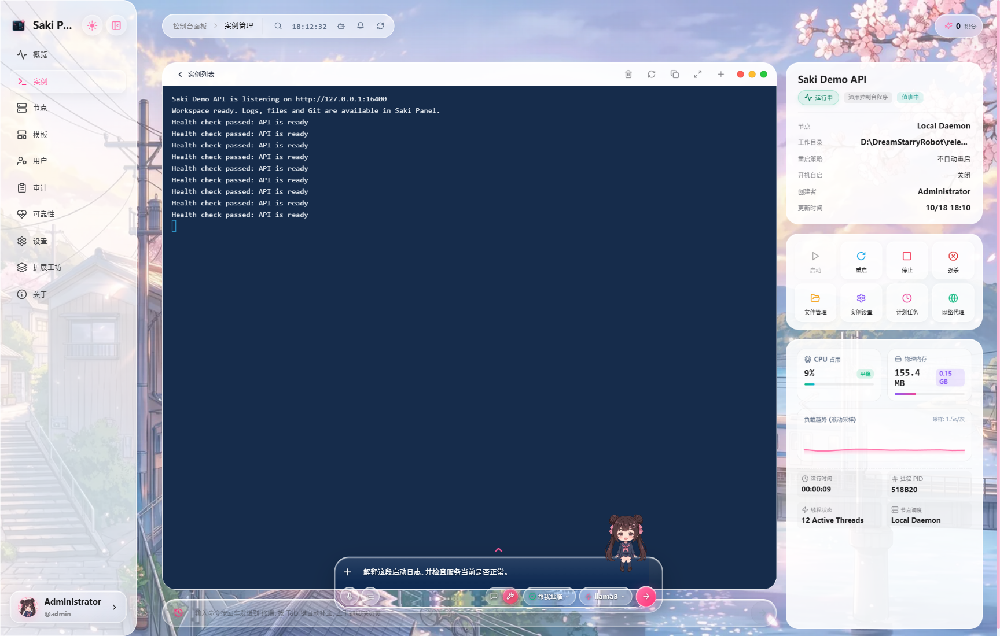

# Saki Panel

**把 AI 放进服务器工作区的开源运维面板。**

在一个 Web 控制台管理 Minecraft、Steam、Docker 和常规进程；Saki 可以结合实时日志、文件与节点指标协助排障，并在授权后执行操作。

[查看界面](#界面预览) · [排障实测](docs/case-studies/port-recovery/README.md) · [快速开始](#快速开始) · [下载发行版](https://github.com/EthanChan050430/Saki-Panel/releases/latest) · [English](README.md)

https://github.com/user-attachments/assets/99a8d410-c079-4368-86c9-f847413d4580

## 界面预览

5.0 的概览页把 Saki 助手、实时系统指标和多个工作区放在一起。上方海报保留了运行中界面的原始截图，点击即可查看原图；示例中运行的是本地演示服务。

在实例的 Git 工作区查看文件差异、选择要提交的文件，并浏览版本记录。

Saki Panel 把实例、节点、终端、文件、数据库与权限管理放在同一工作区。排查故障时，Saki 可以读取当前实例的状态和日志，给出诊断与待确认的操作，而不必在面板、终端和聊天工具之间反复复制内容。

## 核心能力

| 场景 | 可以做什么 |
|:---|:---|
| **AI 协助运维** | 用自然语言查询状态与日志、阅读和修改工作区文件、管理实例、执行受控命令；支持 Skills、MCP 和图片／日志附件。 |
| **Saki Watch 故障响应** | 记录异常退出与错误指纹，发起诊断，审阅补丁，并在验证失败且满足条件时回滚本次修改。 |
| **实例与节点** | 通过 SSH 连接远程 Linux 服务器；集中管理 9 类实例及多台 Daemon 节点，包括 Minecraft、Steam、Docker 容器与 Compose。 |
| **日常管理** | Web 终端、文件编辑与传输、Git 可视化差异、SQLite／MySQL／PostgreSQL／Redis、定时任务和实例模板。 |
| **可观测与协作** | 集群看板、可靠性统计、审计日志、角色权限；故障通知支持 Webhook、钉钉、企业微信和 Telegram。 |
| **扩展** | 插件工坊支持主题、Saki 形象、游戏、组件和语言包；运维包提供可按需导入的模板与 Runbook。 |

Saki 可连接本地 Ollama、LM Studio，也支持在设置中配置云端模型。本地模型可以避免将模型推理请求发送到云端；使用云端模型、在线插件或运维包时，相应功能仍会访问外部服务。

概述页 Agent 的「添加工作区」支持同时勾选最多 8 个实例，包含本地与 SSH 远程实例。可以指定默认工作区，并在同一段对话中读取、修改和比较多个工作区；每个目标分别校验权限。工作区选择会随会话保存，执行任务或等待审批、回答时暂时锁定。

## 快速开始

### 从源码在本机运行

需要 Node.js ≥ 22.13 和 npm ≥ 9。

~~~bash
git clone https://github.com/EthanChan050430/Saki-Panel.git
cd Saki-Panel
npm install
npm run db:push
npm run dev
~~~

打开 [http://localhost:5478](http://localhost:5478)。Panel API 默认使用 `5479`，本地 Daemon 默认使用 `5480`。开发环境默认账号是 `admin` / `admin123456`；连接其他设备或对外开放服务前，请先更改默认密码和密钥。

Windows、Linux 和 macOS 的开发启动脚本分别位于 `scripts/windows/start-dev.ps1`、`scripts/linux/start-dev.sh` 和 `scripts/macos/start-dev.command`。如果 [Releases](https://github.com/EthanChan050430/Saki-Panel/releases/latest) 中提供与你的系统匹配的发行包，也可以直接选择对应版本。

### 使用预构建 Docker 镜像

在要部署的目录下载 [docker-compose.ghcr.yml](docker-compose.ghcr.yml)，并创建 `.env` 文件：

~~~dotenv
JWT_SECRET=换成足够长的随机密钥
ADMIN_PASSWORD=换成强密码
DAEMON_REGISTRATION_TOKEN=换成独立的随机令牌
~~~

~~~bash
docker compose -f docker-compose.ghcr.yml pull
docker compose -f docker-compose.ghcr.yml up -d
~~~

默认 Web 地址是 `http://localhost:5478`。跨主机或公网部署时，按实际域名配置 `WEB_ORIGIN`、`PANEL_PUBLIC_URL` 和 `PANEL_CORS_ORIGINS`，为 Web、Panel 与远程 Daemon 配置 HTTPS，并限制暴露端口。节点令牌用于身份认证；默认 HTTP 连接不提供传输加密。Compose 文件会将 Docker socket 挂载到 Daemon，部署前应确认该节点的权限范围。

需要源码构建镜像时，使用仓库中的 [docker-compose.yml](docker-compose.yml)，将上述密钥写入 `.env` 后运行 `docker compose up -d --build`。更多可配置项见 [.env.example](.env.example)。

## 通过 SSH 连接远程服务器

在“实例与数据库”页点击 **SSH 连接**，填写服务器地址、SSH 端口、用户名，以及密码或 SSH 私钥（支持带口令的私钥）。先测试连接并核对主机指纹，再连接服务器。此操作需要 `node.create` 权限。

连接成功后直接打开服务器交互终端，使用 SSH 登录账号的默认目录和权限。连接无需启动命令、Node.js、npm、SFTP 或 Daemon，也不会在服务器上安装软件。支持多个独立终端标签、窗口大小调整、Ctrl+C 等交互输入、全屏和重连；已保存的服务器显示在“远程服务器”列表中。打开终端需要 `node.view` 和 `terminal.view`，输入需要 `terminal.input`；仅服务器所有者或具备既有节点访问权的账号可连接。

若需要单独托管某个进程，再点击“创建托管实例”。只有这一步需要启动命令，并在首次使用时安装运行组件；远程服务器此时需要 Linux、Node.js ≥ 22.13、npm、SFTP、SSH TCP 转发和 npm 仓库访问权限。从源码开发时，需先构建 Daemon。组件安装在 SSH 用户目录的 `.saki-panel/nodes/<节点编号>`，仅监听远程回环地址，无需额外开放公网端口。实例工作目录可以留空自动创建，也可填写 Linux 绝对路径。创建的实例仍可在 SakiAgent 中选择和使用。

SSH 凭据加密保存在面板的 `data/panel/ssh-nodes` 中，备份时需保留其中的加密密钥。每次重新连接都会校验已保存的主机指纹。关闭终端会结束该 SSH shell；删除节点会关闭活动终端并移除保存的凭据。若曾创建托管实例，远程运行组件及其工作目录保留，并在需要实例管理连接时按需恢复。

## Saki 如何协助排障

Saki 能结合当前实例的状态、日志、文件与资源指标回答问题，并通过受限工具执行实例和文件操作。操作按风险分级；需要批准的动作会先展示给用户，部分危险命令由 Daemon 拦截。实际效果取决于所选模型、授权范围和节点环境。

例如可以让它“检查实例退出前的日志并找出可能的配置错误”，或“重启服务后观察新日志”。也可以在聊天中附上截图或日志文件。常用流程可保存为 Skills，外部工具可通过 MCP 接入。

## Saki Watch 如何处理故障

1. 实例意外退出后，Daemon 记录退出信息和错误指纹；此时默认不会调用模型。
2. 默认由用户从事件通知中启动 AI 诊断。管理员也可以为实例启用自动诊断。
3. 诊断阶段读取日志和文件；拟议修改以差异形式展示。默认需要人工批准。
4. 可选的自动批准策略只适用于符合风险、置信度、补丁范围和实例状态限制的小补丁。
5. 应用补丁后进行重启与验证。若验证检测到相同故障或配置的健康检查失败，且存在可用的回滚检查点和操作用户，系统尝试撤销本次修改；其他情况会在事件中说明，供人工处理。

Watch 还支持冷却时间、运行次数限制、通知渠道与升级提醒。相关选项可在实例设置及系统设置中配置。

### 可复现排障实测

[端口配置错误：诊断、审批与恢复](docs/case-studies/port-recovery/README.md) 提供故意注入故障的示例服务，以及实际 Ollama 模型调用、原始补丁、审批前后配置、健康检查和界面截图。本次实测先发现并修复了 Watch 文件编辑绕过审批的问题，再完成重测；报告保留了此前的连接失败和错误端口修复被回滚的记录，并注明使用的源码修订和限制。

## 面板与扩展

支持的实例类型：`generic_command`、`nodejs`、`python`、`java_jar`、`shell_script`、`docker_container`、`docker_compose`、`minecraft`、`steam_game_server`。实例页提供启停、日志、进程探测及可选代理设置；模板可以复用启动命令和环境变量。

文件管理支持浏览、编辑、上传下载及常见压缩包处理；数据库工作区支持 SQLite、MySQL／MariaDB、PostgreSQL 和 Redis。任务页提供定时执行与运行记录；用户、角色和审计功能用于分配权限与追踪操作。

插件工坊支持五类插件：[主题、形象、游戏、组件和语言包](https://github.com/EthanChan050430/saki-plugins)。模板页还提供按需下载的 **Minecraft Paper** 与 **Docker Compose 服务守护** 运维包。下载会校验资源哈希和大小；导入模板或 Runbook 需要单独操作，下载本身不会执行脚本或修改实例。发布细节见 [运维包说明](operations-packs/README.md)。

## 架构与开发

~~~text
Web (React / Vite)  ──HTTP / WebSocket──  Panel (Fastify / Prisma)
                                               │
                                          HTTP / WebSocket
                                               │
                                      Daemon (每个节点运行)
                                               │
                                         服务与游戏实例
~~~

`apps/web` 是 Web 控制台，`apps/panel` 提供 API、认证、审计与 Saki，`apps/daemon` 管理节点上的进程和文件，`packages/shared` 存放共享协议，`prisma` 存放数据库 schema。

~~~bash
npm run dev                 # 同时启动 Panel、Daemon 和 Web
npm run build               # 构建全部工作区
npm run check               # TypeScript 检查
npm run test:watch          # Watch 审批与诊断上下文回归测试
npm run db:push             # 同步 SQLite schema
npm run verify:operation-packs
~~~

开发与贡献见 [CONTRIBUTING.md](CONTRIBUTING.md)；报告安全问题见 [SECURITY.md](SECURITY.md)。

## 许可证

Apache License 2.0，详见 [LICENSE](LICENSE)。
