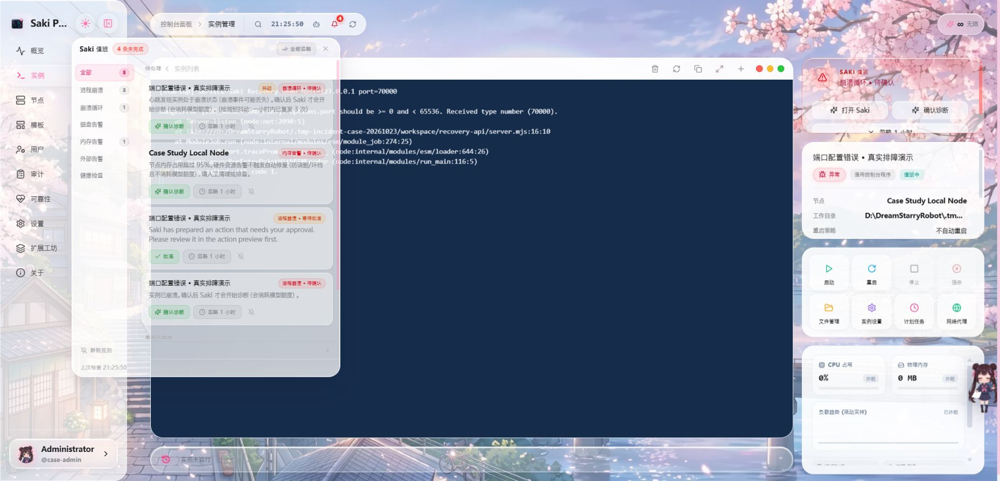
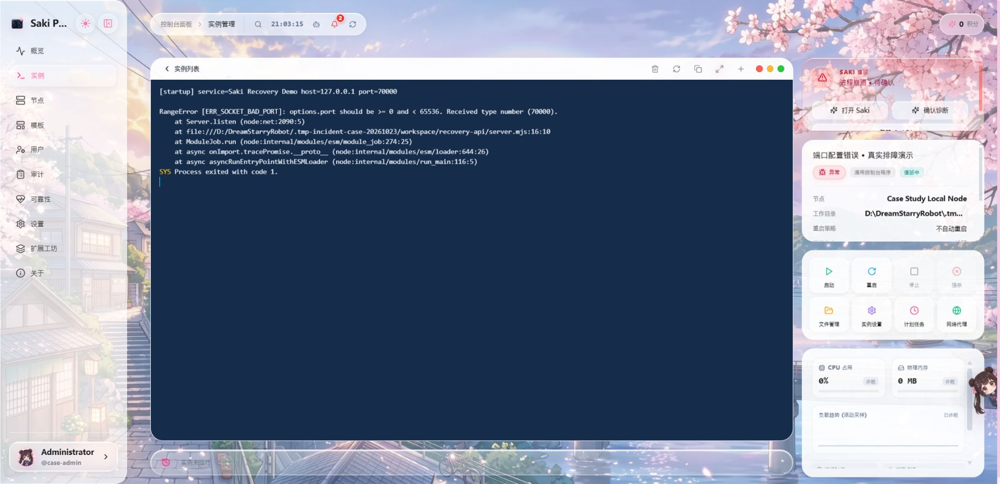
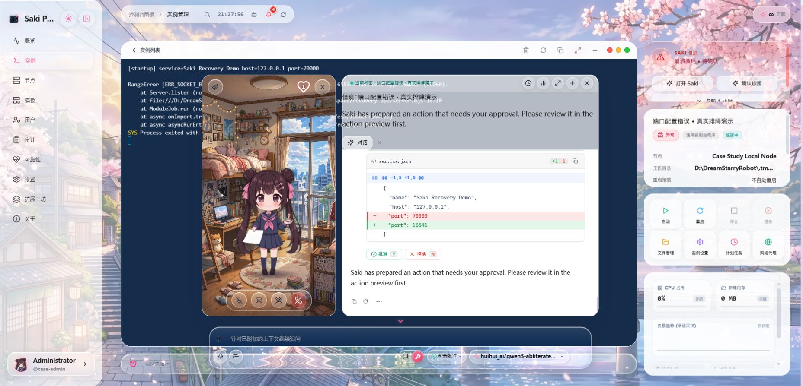
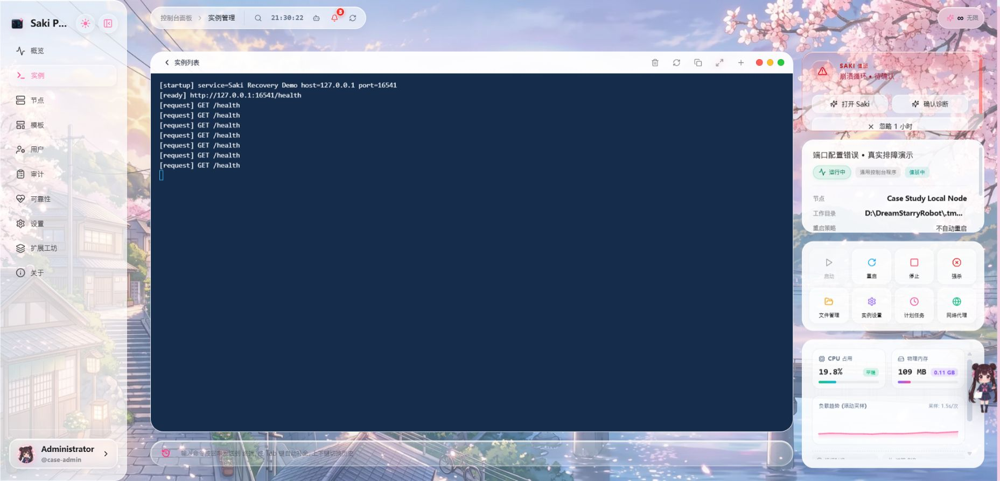

# 一次端口配置错误的真实排障：Saki Watch 的诊断、审批与恢复

本案例在隔离的 Windows 本机环境中人为注入一个端口配置错误，实际调用模型，再通过 Saki Watch 的审批和验证流程恢复服务。它是可复现的产品演示，不是生产故障，也不是通用排障成功率评测。

## 实测结果

- 运行日期：2026 年 10 月 23 日（北京时间）。
- 面板：以 5.0.0 Windows 发行包为基础，加入本次发现问题后的审批修复及健康检查上下文修复；Node.js v22.15.0。不是未经修订的已发布版本。[修订记录](panel-revision.json)。
- 模型：ollama / `huihui_ai/qwen3-abliterated:latest`（本机已有模型，8.2B、Q4_K_M）。Ollama 0.15.4，上下文 16384；RTX 3060 8 GiB、系统内存 15.8 GiB。模型 digest 见 [local-model.json](local-model.json)。
- 诊断到生成待审批补丁：249.3 秒。
- 提交审批到 Watch 标记恢复：34.5 秒，包含 10 秒验证等待窗口及审批后的模型处理。
- 审批等待：181.7 秒（操作者核对与截图）；从发起诊断到恢复总计 465.6 秒，包含这段等待。
- 模型请求：5 次；模型目录查询不计入。
- 上述请求的模型加载耗时合计：146.3 秒；返回的 token 用量合计：33965（输入重复上下文按各请求分别计数）。
- 服务状态：`CRASHED` → `RUNNING`；事件状态：`resolved`。
- 独立健康检查：3 次 HTTP 200，并核对 JSON 中的服务名和 `status: ok`。
- 实际账单金额未取得，不能把面板积分或 token 估计当作货币费用。请求计量详见 [provider-usage.json](provider-usage.json)。

## 实测先发现了什么问题

最初的本地模型诊断读了应用和配置，但没有确认预期端口，就把 `70000` 改为 `3000`。健康检查仍指向 `16541`，因此验证失败，Watch 把配置回滚到 `70000`。本次实际验证了失败后的配置回滚；回滚没有自动停止已在错误端口运行的进程，下一轮前由操作者停止该实例。

同时发现一个审批缺陷：普通 Agent 的文件编辑自动接受规则覆盖了 Watch，导致关闭自动批准时仍直接写文件。本次修复让 Watch 的所有配置修改先进入审批，再由事件的独立策略决定是否允许自动批准；诊断上下文也增加了去掉凭据和查询参数的健康检查目标，要求模型依据部署信息选择端口。5 项回归测试及全项目类型检查通过。修复前的结果见 [before-fix-attempt.json](before-fix-attempt.json)，未删除失败记录。以下展示修复后的同一故障重测。



## 1. 复现故障

演示服务只有一个 Node.js HTTP 文件和一个 JSON 配置。预定地址为 `127.0.0.1:16541`，配置却把端口写成了 `70000`，超出 TCP 端口范围。启动命令始终是 `node server.mjs`，重启策略为 `never`。

实际日志包含：

```text
RangeError [ERR_SOCKET_BAD_PORT]: options.port should be >= 0 and < 65536. Received type number (70000).
Process exited with code 1.
```



## 2. 让 Saki 自己诊断

自动诊断关闭；操作者从已记录的事件发起诊断。面板自动发送退出码、启动命令、工作目录、近期日志和事件证据。没有手工指定应修改哪一行，也没有模拟模型响应。模型可读取工作区中说明了预期端口的 README；因此本案例并不测试“无提示猜端口”的能力。

模型实际调用顺序：`describeInstance` → `readFile` → `readFile` → `replaceInFile`。完整工具参数和结果见 [actions.json](actions.json)，不发布模型内部思考内容。

## 3. 审阅补丁后批准

模型提出的原始补丁保存在 [proposed.patch](proposed.patch)。改动将 `service.json` 的端口从 `70000` 改为 `16541`。审批前重新读取磁盘配置，确认仍为错误值；`server.mjs`、绑定地址和启动命令均未修改。

本次没有启用自动批准。审批由协助制作演示的 Codex 作为操作者审阅截图中的差异后，通过面板 API 提交；没有点击截图中的批准按钮。不应描述成用户本人手动点击或完全无人值守修复。



## 4. 重启与验证

批准后由 Watch 启动实例，等待 10 秒验证窗口并检查配置的 HTTP 健康接口。之后又独立请求 3 次，核对 HTTP 状态和响应内容。

```json
{"status":"ok","service":"Saki Recovery Demo"}
```



## 时间与证据

| 事件 | 北京时间 |
| --- | --- |
| 发起诊断 | 2026/10/23 21:20:54 |
| 生成待审批动作 | 2026/10/23 21:25:03 |
| 提交审批 | 2026/10/23 21:28:05 |
| Watch 标记恢复 | 2026/10/23 21:28:39 |

[实测指标](result.json) · [故障日志](before.txt) · [恢复日志](after.txt) · [事件结果](incident.json) · [审批差异](approval.json) · [源文件哈希](source-hashes.json) · [实现修复补丁](implementation.patch) · [验证记录](validation.md)

## 自行复现

1. 将 [示例文件夹](../../examples/port-recovery/) 复制到独立工作目录，保留其中故意错误的 `service.json`。
2. 在 Saki Panel 配置可用的模型和调用凭据，并保证操作账号有 Saki 使用权限及足够的面板积分（测试管理员可设置内部无限积分，这不提供模型服务商额度）。
3. 创建 Node.js 实例，工作目录指向复制目录，命令设为 `node server.mjs`，重启策略选“不自动重启”。
4. 启用 Watch 的“诊断与补丁”，关闭自动诊断及自动批准，验证等待设为 10 秒，健康检查填 `http://127.0.0.1:16541/health`。测试前确认该端口没有被其他服务占用。
5. 启动实例，等待崩溃事件；从事件发起诊断，核对真实修改差异后批准。
6. 在示例目录运行 `node verify-health.mjs`，应得到连续三次 HTTP 200 和正确 JSON。模型和网络不同，耗时及结果可能不同。

## 局限与制作说明

- 这里只验证一个明确的配置错误；不能据此推断复杂故障、安全性或生产适用性。
- 本机同时运行其他应用，过程中出现内存占用告警；本次耗时不是独占机器的速度基准。
- 已完成事件的摘要仍保留旧的待审批文案，末尾附带健康检查通过信息；本例据事件状态、磁盘配置、进程日志和独立 HTTP 检查判定恢复。截图也保留了前序实验的其他未处理事件，没有改写界面内容。
- 修复后的这一轮恢复成功，未触发回滚。修复前一轮实际触发了配置回滚，相关证据单独保留，不能据此推断所有故障都会回滚。
- 准备阶段启动了两次错误配置：第一次发现 Windows PTY 丢失快速退出前的错误文本，因此给示例增加了 500ms 错误输出等待，再复现故障。两次故障都出现在诊断上下文中。
- 新建演示账号最初因内部积分为零被拒绝诊断；设置内部积分后才发起实际模型请求。准备过程不计入模型诊断耗时。
- 最初使用已配置的 NVIDIA / z-ai/glm-5.3-flash；4 次网络请求均未取得模型响应。该次失败完整保留在 [previous-attempt.json](previous-attempt.json)，没有宣称首轮成功。随后改用本机已有的 Ollama 模型，测试实例冷却时间从 900 秒调整为 60 秒。上方耗时只计算修复后的本地模型这一轮，不包括前次网络失败、修复前的本地模型尝试及环境准备。准备阶段另有云端连通性探测，其中一个小请求成功，不将它混入案例的模型请求数。
- 为记录模型请求次数和供应商返回的 usage，调用经仅监听本机的透传计量代理转发至原配置服务；代理不生成或替换模型输出。
- 使用隔离的数据库、节点身份和工作区；只复用本机已配置的模型连接。公开证据不包含 API Key、会话令牌或完整模型设置。截图来自实际面板，未重绘界面。
- 证据采集后已停止本次演示服务，并清理临时模型设置副本；这里的运行状态和耗时对应采集时刻。
